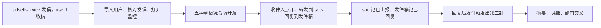

# 识饵（Shier）

识饵是面向钓鱼演练与安全意识培训的管理平台，由咨询方（乙方）用于组织演练、展示结果，并服务甲方安全运营与意识培训负责人。

## 与 Gophish 的关系

本项目基于开源项目 [Gophish](https://github.com/gophish/gophish) 改造，并在原有能力上扩展了多手法剧本、发送通道、中英双语管理界面、演练结果分析，以及面向外部模型的 REST 配置能力等。

- **不是**官方 Gophish，也**不代表** Gophish 上游项目或其作者。
- 产品名称、界面品牌与文档中的「识饵 / Shier」仅用于本分支的衍生作品标识。
- 代码中仍可能保留 `gophish` 作为模块路径、二进制名、配置文件名或内部标识，以便与上游兼容、便于合并更新；这不改变本仓库的产品品牌。

上游项目主页：[https://getgophish.com](https://getgophish.com)  
上游源码：[https://github.com/gophish/gophish](https://github.com/gophish/gophish)

## 开源许可与版权声明

上游 Gophish Community Edition 使用 **MIT License**。MIT 允许修改、再分发与商业使用，但要求：

1. 保留原作者版权声明与许可全文；
2. 在再分发的副本或实质部分中附带上述声明。

因此本仓库：

- 完整保留上游 `LICENSE`（Copyright (c) 2013-2020 Jordan Wright）；
- 在 README 中明确标注本项目为基于 Gophish 的衍生改造；
- 对本分支新增与修改部分，在适用范围内继续按 MIT 条款使用与分发。

请勿删除、改写或隐藏 `LICENSE` 中的上游版权与许可文本。若对外发布二进制或源码包，请一并附带本 `LICENSE` 与本 README 中的出处说明。

完整许可文本见仓库根目录 `[LICENSE](./LICENSE)`。

## 主要能力（本分支）

- 钓鱼演练活动管理、结果统计与部门 × 手法维度分析
- 内置剧本包（链接、附件、二维码、短信、即时通讯、日历、回复等多手法）
- 非邮件发送通道（短信 HTTP 网关、即时通讯 Webhook 风格配置）
- 管理端中英双语
- 面向外部 AI / 自动化的 REST API

## 本地运行（简要）

本仓库默认配置见 `config.json`：管理端约 `:13333`，钓鱼监听端约 `:18000`。

从源码构建（需安装 Go）：

```bash
go build
./gophish
```

启动后在浏览器打开管理端地址，使用日志中打印的初始管理员账号登录。

阿里云企业邮箱上已经跑通的邮件演练，按下面的使用说明操作。实验室 Mailpit 联调仍写在本地 `docs/`，不随仓库发布。

## 使用说明：阿里云企业邮箱邮件演练

下面是已经在阿里云企业邮箱上跑通的邮件通道演练。短信和即时通讯未接入，不导入 `sms_parcel_pickup`、`im_meeting_card`，也不创建发送通道。

识饵负责导入收件人、用企业邮箱发信、凭确认令牌开演、在上报邮箱记下转发、在发件箱记下回复，再用接口汇总结果。打开邮件、点链接、打开附件、回复，以及把可疑信转发到上报邮箱，都由收件人本人完成。点开之后，钓鱼监听会记下打开和点击。




### 环境

- 管理端 `:13333`，钓鱼监听 `:18000`，库文件为仓库内 `gophish.db`。钓鱼地址用识饵所在电脑的局域网地址，已跑通的是 `http://192.0.2.208:18000`。打开邮件的设备，包括扫二维码的手机，都要能访问这个地址。
- 域名 `example.local` 的邮件交换记录指向 `mx1.qiye.aliyun.com`、`mx2.qiye.aliyun.com`、`mx3.qiye.aliyun.com`，SPF 为 `include:spf.qiye.aliyun.com`。
- 发信服务器是 `smtp.qiye.aliyun.com:465`，连接时直接加密。这台网络连不上该主机的 587 端口，发信配置保持 465。
- 识饵里的发信配置「阿里云企业邮箱」指向这台服务器。发件人是 `adselfservice@example.local`，用户名是同一地址。发信配置不写 `Reply-To`。回复进入这个发件箱，上报转发进入 `soc@example.local`。口令只放在识饵的发信配置和 IMAP 配置里。
- 调用管理端接口使用管理员的 API 密钥，请求头为 `Authorization: Bearer <api_key>`。

### 三个邮箱

五种手法都发给同一个人：


| 角色  | 地址                            | 用途                                                        |
| --- | ----------------------------- | --------------------------------------------------------- |
| 收件人 | `user1@example.local`         | 财务甲，财务部，出纳。人工在网页邮箱 `https://qiye.aliyun.com` 里打开、点开、转发和回复 |
| 发件人 | `adselfservice@example.local` | 发信配置「阿里云企业邮箱」。回复回到这只邮箱，识饵在这里记已回复                          |
| 上报  | `soc@example.local`           | 只收转发。识饵在这里记已上报                                            |


发件人和上报邮箱都不放进收件人组。演练原信只发往 `user1`。`soc` 里若留着未读的演练原信，会被记成已上报。

导入用户之前，先向 `user1@example.local` 发一封试信，能在该邮箱里打开，才算收件人可用。再对 `soc@example.local` 调用 `POST /api/imap/validate`。校验失败时先核对 IMAP。没有 IMAP，上报和回复都记不下来。发信配置的用户名必须是完整邮箱，口令要能登录同一台 IMAP；没有用户名的配置不会被拿来读回复。

### 导入收件人并核对发信

准备一份 CSV，表头为 `First Name`、`Last Name`、`Email`、`Position`、`Department`。只放财务甲一行，邮箱是 `user1@example.local`。

1. `POST /api/import/group` 上传 CSV。这个接口只解析，不落库。
2. 把返回的成员交给 `POST /api/groups/`。
3. `GET /api/smtp/`，找到「阿里云企业邮箱」。核对主机是 `smtp.qiye.aliyun.com:465`，发件人和用户名都是 `adselfservice@example.local`。

### 打开上报监控

上报靠收件人把可疑信转发到 `soc@example.local`。识饵读这只邮箱：主题以 `Fwd:`、`FW:` 或「转发」开头，或正文、附件里有 `rid=`，记为已上报。已上报单独计数，不覆盖已点击等漏斗状态。

`POST /api/imap/` 保存并启用，字段按下面填写。`port` 和 `imap_freq` 在 JSON 里是字符串。口令放在 `password` 字段，不写入文档。

- `host`：`imap.qiye.aliyun.com`
- `port`：`"993"`
- `tls`：真
- `username`：`soc@example.local`
- `restrict_domain`：`example.local`
- `imap_freq`：`"30"`
- `folder`：`INBOX`
- `delete_reported_campaign_email`：假
- `enabled`：真

保存后用 `GET /api/imap/` 确认 `enabled` 为真。管理端进程要处于运行中，轮询才会发生。打开监控时，`soc` 里已有的未读信若没有演练编号 `rid=`，只会被标成已读，不会记成已上报。

转发从 `user1@example.local` 发到 `soc`。

### 五种手法开演

每种手法一张草稿、一次令牌开演。场景包见 `models/scenariopacks/manifest.json`。

除回复手法外，每张草稿先 `POST /api/ai/plans/dry_run`，再 `POST /api/ai/plans/`，并带请求头 `Idempotency-Key`。创建草稿不会发信。草稿阶段 `user1` 不应收到这封信。

链接手法带 `template_id`、`page_id`、`group_id` 和 `channel.smtp_id`。附件、二维码、日历带 `scenario_pack_id`、`group_id` 和 `channel.smtp_id`。

开演时先 `POST /api/ai/campaigns/{id}/prepare_launch` 取得一次性 `confirm_token`（约 15 分钟、单次有效，且活动必须仍是草稿），再 `POST /api/ai/campaigns/{id}/launch`，请求体为 `{ "confirm_token": "..." }`。管理界面上由人点击开演时，走 `POST /api/campaigns/{id}/launch`，该路径只对草稿有效。`POST /api/campaigns/` 在开演时间是现在或过去时会立刻发信，这次演练不用它来创建活动。

令牌开演后，用 `GET /api/campaigns/{id}/results` 确认一条已发送，再在 `user1@example.local` 里找这封信。收件箱和已发送里都没有时，先查阿里云企业邮箱的拦截记录和垃圾箱。

五种手法如下。

- **链接** `multistep_it_notice`。先 `POST /api/scenario_packs/multistep_it_notice/import`。返回的 `template_id` 是没有链接的铺垫信，返回的 `page_id` 是确认页。接着 `GET /api/templates/`，选用名称是 `[多步骤] IT系统升级-确认` 的模板。这个名字已经存在时，新导入的名字是 `[多步骤] IT系统升级-确认 (导入)`。建草稿时带这封确认信的 `template_id` 和导入返回的 `page_id`，不带 `scenario_pack_id`，也不使用导入返回的 `template_id`。
- **附件** `office_macro_openurl`。平台确认收件邮箱里这封信带有附件。
- **二维码** `qr_account_verify`。平台确认邮件里有内嵌二维码。扫码的设备必须能打开上面的钓鱼地址。
- **日历** `calendar_video_meeting`。平台确认附件是含 `BEGIN:VCALENDAR` 的 `.ics`。
- **回复** 按下一节建两步草稿，不单靠 `scenario_pack_id`。

到这里平台停手，把五封信的主题、收件地址、上报邮箱和回复应回到的发件箱交给收件人。

### 回复手法

回复和上报是两条线。`soc` 只收转发。收件人点「回复」时，信回到 `adselfservice@example.local`。发信配置写成 `Reply-To: soc@...` 时，回复会进上报邮箱，和转发混在一起。

这个手法测的是先回复、再收到第二封。第一封只要求回复，第二封才带需要打开的链接，并且只在记下回复之后发出。两步挂在同一个活动上。

1. 第 0 步，触发「发出后」，延迟 0。模板用场景包 `reply_meeting_confirm` 的「[会话] 会议出席请回复确认」。正文请收件人直接回复本邮件，说明是否出席。里面的链接是可选的，点不点都不算这个手法完成。
2. 第 1 步，触发「用户回复后」，延迟 0。另建一封模板，名称「[会话] 会议材料请查收」，主题「会议材料已备好，请在会前查看」。正文写明已收到出席回复，并给出 `{{.URL}}`。落地页沿用会议出席确认那一页。

`POST /api/ai/plans/` 只导入场景包的一封模板，请求体不接收 `steps`。只传 `scenario_pack_id` 时，开演后只有第 0 步：回复能记下，但没有第二封可发。当前这条接口不能把第 1 步写进草稿。要发出第二封，活动在领取确认令牌之前就要已经带上上面两步；已经开演的活动不能再补步。管理界面把开演时间设成现在或过去时会立刻发信，这一步也不走确认令牌。

记下回复要同时满足这些条件：

- 信在发件箱的收件箱里，并且尚未被标为已读。监控只扫未读。网页邮箱若先把回复标成已读，这一轮就看不到。
- 发件人是该结果的邮箱，这里是 `user1@example.local`，域名还要落在 IMAP 的限制域名 `example.local` 里。
- `In-Reply-To` 或 `References` 对上这次发送保存在 `mail_logs` 里的 `Message-ID`。识饵每次发送只保存一个编号。同一活动若发出两份副本，回复另一份对不上，不会记已回复，也不会发第二封。
- 主题不是 `Fwd:`、`FW:` 或「转发」。发件箱里的转发不当成回复。Apple Mail 转发的主题是 `Fwd:`，原信 `Message-ID` 在 `References` 里，这类信按上报处理。

第一次对上时，结果的 `replied` 变为真，时间线增加 `Email Replied`。当前漏斗状态保持不变，也不记已上报。然后按第 1 步的延迟入队。延迟为 0 时，下一轮发信把第二封交给 `user1`。第二封的主题若还没有 `Re:`、`回复:` 或 `答复:`，会自动加上 `Re:` 。`In-Reply-To` 和 `References` 指向第一封保存的编号，所以它和原信在同一会话里。同一结果只入队一次，之后再回复不会再发一封。

收件人发出回复后，发件箱收件箱里应能看到这封 `Re:`，并先留着未读。约半分钟内，结果页出现已回复；再过一轮，`user1` 收到第二封。发件箱已经有回复、识饵仍没有已回复时，先核对编号是不是被阿里云企业邮箱改写，或回复的是另一份副本。这两种都记不下来，写进报告即可。第二封发出后，打开里面的链接仍由钓鱼监听记打开和点击。

### 收件人侧

在 `user1@example.local` 里由收件人自己做，做多少由当场决定。邮件客户端需要显示远程图片，打开才会被记下来。转发和回复的发件账户都选 `user1`。

- 点开邮件、链接、二维码或日历邀请里的地址。打开和点击由钓鱼监听记账。
- 下载并打开附件。附件没有打开页面时，用这封信正文里的链接。
- 上报：把可疑信转发到 `soc@example.local`，保留原信里的链接或附件。约半分钟内，监控把财务甲标成已上报。摘要里的 `email_reported` 单独计数。
- 回复手法：回复第一封会议信。收件人保持 `adselfservice@example.local`，让邮件客户端自己带上 `In-Reply-To`。留下未读，等已回复出现后，再在 `user1` 里查第二封会议材料。打开第二封里的链接才记点击。

### 取结果并结束投放

收件人做完之后再取数。

- 每个活动调用 `GET /api/campaigns/{id}/summary` 和 `GET /api/campaigns/{id}/results`。摘要里的 `email_reported`、结果里的 `reported` 和 `replied`、时间线里的 `Email Reported` 与 `Email Replied`，都写入报告。
- `GET /api/campaigns/breakdown` 看部门点击率，以及部门与手法的交叉。这次只有财务部一行。
- 每个活动调用 `GET /api/campaigns/{id}/complete`，结束投放。

报告写明每种手法是否发出，以及实际产生了哪些打开、点击、上报和回复。回复手法还要写明第一封是否记上已回复、第二封是否在回复之后才出现在 `user1`。摘要、结果和交叉分析就是数据来源。


## 分支与上游同步

定制开发在 `shier` 分支进行。官方 Gophish 远程通常命名为 `upstream`，用于拉取上游更新；请勿将本分支的定制提交直接推送到官方上游仓库。

## 致谢

感谢 [Jordan Wright](https://github.com/jordan-wright) 与 Gophish 社区提供的开源基础。本项目中所有对上游代码的使用，均遵循其 MIT 许可约定。