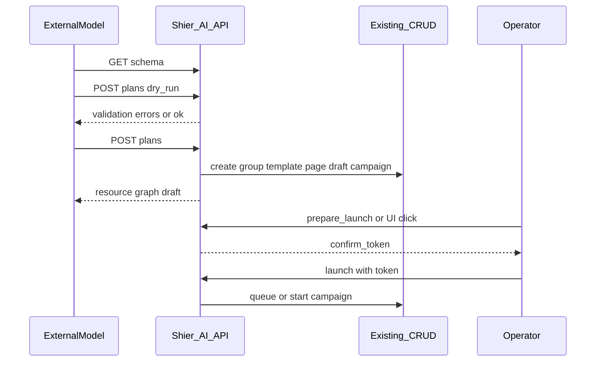

# 识饵 AI 可配置 API 决策

| 项 | 内容 |
|---|---|
| 状态 | **已批准**（2026-09-20）；核心编排 API 已落地（见 §9） |
| 日期 | 2026-09-20 |
| 范围 | 对外 REST API 能力边界、现有功能↔API 全量对照、面向外部模型的编排层规格。不含具体模型提示词、不含产品内对话 UI |
| 关联 | 产品定位为乙方交付工具；前端选型见 `docs/ui-frontend-stack-decision.md` |
| 结论摘要 | **只提供可被任意模型调用的 REST API**（产品内不做内置 Copilot）。AI 可自动完成配置；**开启发送**必须管理后台人工确认，或携带**一次性确认令牌**。先补齐「草稿 vs 发送」语义与编排层，再写代码 |

本文件为产品与 API 规格决策。实现进度见 §9。

---

## 1. 要回答的问题

1. 外部模型（或任意智能体）如何安全、可重复地把「演练意图」落到识饵？
2. 现有 CRUD API 是否足够？缺什么编排层？
3. 如何防止模型误触大规模投放？

---

## 2. 产品定位（决策基线）

| 项 | 约定 |
|---|---|
| 使用者 | 乙方交付顾问为主；甲方主要查看演练成果 |
| 短周期目标 | 加速配置与交付，不做「卖给甲方的自助 SaaS」 |
| AI 形态 | **模型无关的 API**；密钥与对话编排留在调用方 |
| 发送权 | 人点确认，或 API 带 `confirm_token`；AI 默认不可直接开演 |

---

## 3. 现状基线（代码事实）

| 层 | 现状 |
|---|---|
| API 入口 | `controllers/api/server.go`：前缀 `/api/`，全局 `RequireAPIKey` + `EnforceViewOnly`（非 GET 需 `modify_objects`） |
| 认证 | Query `api_key` 或 `Authorization: Bearer` |
| 行动创建 | `POST /api/campaigns/` → `models.PostCampaign`；若状态为进行中，handler 会 `go worker.LaunchCampaign`（见 `controllers/api/campaign.go`） |
| 场景素材 | `GET /api/scenario_packs/`、`POST /api/scenario_packs/{id}/import` |
| 多通道 | SMTP（`/api/smtp/`）+ Sending Channels（`/api/sending_channels/`，短信 HTTP / 即时通讯 Webhook） |

**核心缺口（相对本决策）：** 今日「创建活动」与「开始投放」未拆分。`POST /api/campaigns/` 在 `launch_date` 已到或为空时会进入 `In progress` 并触发 worker。实现阶段必须引入**草稿行动**或强制「未来 launch_date + 显式 launch（含确认令牌）」，否则无法满足「AI 可配置、不可擅自发送」。

---

## 4. 功能与现有 API 全量对照

说明：

- 「AI 策略」为本决策约定的**默认策略**（实现后生效；今日代码尚未按此拦截）。
- 取值：`允许配置` / `试发受限` / `发送需确认` / `禁止（系统级）` / `只读`。

### 4.1 全局约定

| 规则 | 说明 |
|---|---|
| 前缀 | 全部位于 `/api/` |
| 认证 | API Key 必填 |
| 写操作 | 非 GET/HEAD/OPTIONS 需具备 `modify_objects` |
| 额外权限 | 下表「额外权限」列；空表示仅全局规则 |

### 4.2 演练活动（campaigns）

| 功能 | Method | Path | 额外权限 | AI 策略 |
|---|---|---|---|---|
| 列出活动明细 | GET | `/api/campaigns/` | — | 只读 |
| 创建活动（今日可立即投放） | POST | `/api/campaigns/` | — | **发送需确认**（实现后：仅允许创建草稿，或未来时刻排队且未 launch） |
| 活动摘要列表 | GET | `/api/campaigns/summary` | — | 只读 |
| 部门 × 手法点击率汇总 | GET | `/api/campaigns/breakdown` | — | 只读 |
| 活动详情 | GET | `/api/campaigns/{id}` | — | 只读 |
| 软删除（移入回收站） | DELETE | `/api/campaigns/{id}` | — | 允许配置 |
| 回收站列表 | GET | `/api/campaigns/trash` | — | 允许配置 |
| 从回收站恢复 | POST | `/api/campaigns/{id}/restore` | — | 允许配置 |
| 彻底删除 | DELETE | `/api/campaigns/{id}/purge` | — | **禁止（系统级）**；须 `{ "confirm": "purge" }`，见 `docs/campaign-soft-delete.md` |
| 结果与事件 | GET | `/api/campaigns/{id}/results` | — | 只读（不含把明文凭据作为 AI 默认可读字段；见 §5） |
| 单活动摘要 | GET | `/api/campaigns/{id}/summary` | — | 只读 |
| 结束活动 | GET | `/api/campaigns/{id}/complete` | — | 允许配置（收尾，非开演） |

### 4.3 目标组（groups）

| 功能 | Method | Path | 额外权限 | AI 策略 |
|---|---|---|---|---|
| 列表（含成员） | GET | `/api/groups/` | — | 只读 |
| 新建目标组 | POST | `/api/groups/` | — | 允许配置 |
| 摘要列表 | GET | `/api/groups/summary` | — | 只读 |
| 详情 | GET | `/api/groups/{id}` | — | 只读 |
| 更新 | PUT | `/api/groups/{id}` | — | 允许配置 |
| 删除 | DELETE | `/api/groups/{id}` | — | 允许配置 |
| 单组摘要 | GET | `/api/groups/{id}/summary` | — | 只读 |
| CSV 解析为目标成员（不落库） | POST | `/api/import/group` | — | 允许配置 |

### 4.4 邮件模板（templates）

| 功能 | Method | Path | 额外权限 | AI 策略 |
|---|---|---|---|---|
| 列表 / 新建 | GET / POST | `/api/templates/` | — | 只读 / 允许配置 |
| 详情 / 更新 / 删除 | GET / PUT / DELETE | `/api/templates/{id}` | — | 只读 / 允许配置 |
| 原始邮件导入为模板内容 | POST | `/api/import/email` | — | 允许配置 |

### 4.5 着陆页（pages）

| 功能 | Method | Path | 额外权限 | AI 策略 |
|---|---|---|---|---|
| 列表 / 新建 | GET / POST | `/api/pages/` | — | 只读 / 允许配置 |
| 详情 / 更新 / 删除 | GET / PUT / DELETE | `/api/pages/{id}` | — | 只读 / 允许配置 |
| 按 URL 抓取 HTML | POST | `/api/import/site` | — | 允许配置（注意目标站合规） |

### 4.6 SMTP 发送配置（smtp）

| 功能 | Method | Path | 额外权限 | AI 策略 |
|---|---|---|---|---|
| 列表 / 新建 | GET / POST | `/api/smtp/` | — | 只读 / 允许配置 |
| 详情 / 更新 / 删除 | GET / PUT / DELETE | `/api/smtp/{id}` | — | 只读 / 允许配置 |
| 测试邮件 | POST | `/api/util/send_test_email` | — | **试发受限**（单收件人；建议审计与频控） |

### 4.7 短信 / 即时通讯通道（sending_channels）

| 功能 | Method | Path | 额外权限 | AI 策略 |
|---|---|---|---|---|
| 列表 / 新建 | GET / POST | `/api/sending_channels/` | — | 只读 / 允许配置 |
| 详情 / 更新 / 删除 | GET / PUT / DELETE | `/api/sending_channels/{id}` | — | 只读 / 允许配置 |
| 用请求体配置试发 | POST | `/api/sending_channels/test` | — | **试发受限** |
| 对已有通道试发 | POST | `/api/sending_channels/{id}/test` | — | **试发受限** |

### 4.8 场景包（scenario_packs）

| 功能 | Method | Path | 额外权限 | AI 策略 |
|---|---|---|---|---|
| 列出内置场景包元数据 | GET | `/api/scenario_packs/` | — | 只读 |
| 导入为模板 / 页面等资源 | POST | `/api/scenario_packs/{id}/import` | — | 允许配置 |

### 4.9 IMAP 举报监控

| 功能 | Method | Path | 额外权限 | AI 策略 |
|---|---|---|---|---|
| 读 / 写 IMAP 配置 | GET / POST | `/api/imap/` | — | 只读 / 允许配置 |
| 校验 IMAP 登录 | POST | `/api/imap/validate` | — | 允许配置 |

### 4.10 用户（users）

| 功能 | Method | Path | 额外权限 | AI 策略 |
|---|---|---|---|---|
| 列表 / 创建 | GET / POST | `/api/users/` | `ModifySystem` | **禁止（系统级）** |
| 详情 / 更新 / 删除 | GET / PUT / DELETE | `/api/users/{id}` | 系统权限或本人（角色变更需系统权限） | **禁止（系统级）**（AI 角色不得改系统用户） |

### 4.11 Webhooks

| 功能 | Method | Path | 额外权限 | AI 策略 |
|---|---|---|---|---|
| CRUD | GET/POST `/api/webhooks/`，GET/PUT/DELETE `/api/webhooks/{id}` | `ModifySystem` | 默认 **禁止（系统级）**；若交付需要可由人工配置 |
| 向远端发校验事件 | POST | `/api/webhooks/{id}/validate` | `ModifySystem` | 禁止（系统级） |

### 4.12 其它

| 功能 | Method | Path | 额外权限 | AI 策略 |
|---|---|---|---|---|
| 重置当前认证用户的 API Key | POST | `/api/reset` | — | **禁止（系统级）** |

### 4.13 管理页 ↔ 主要 API 域

| 管理页 | 功能名 | 主要 API 域 |
|---|---|---|
| `templates/dashboard.html` | 仪表盘 | campaigns：summary / breakdown / delete |
| `templates/campaigns.html` | 活动列表 | campaigns、groups/summary、templates、pages、smtp、sending_channels、util/send_test_email |
| `templates/campaign_results.html` | 活动结果 | campaigns：results / complete / delete / get |
| `templates/groups.html` | 目标组 | groups、import/group |
| `templates/templates.html` | 邮件模板 | templates、import/email、scenario_packs |
| `templates/landing_pages.html` | 着陆页 | pages、import/site、scenario_packs |
| `templates/sending_profiles.html` | SMTP 发送配置 | smtp、util、imap（读） |
| `templates/sending_channels.html` | 发送通道 | sending_channels |
| `templates/settings.html` | 账号 / 报告设置 | imap、reset |
| `templates/users.html` | 用户管理 | users |
| `templates/webhooks.html` | Webhooks | webhooks |

路由注册以 `controllers/api/server.go` 为准；未在该文件出现的路径不视为官方 API。

---

## 5. 权限与安全模型（目标态）

| 能力 | AI 默认可调 | 条件 |
|---|---|---|
| 读 schema / 列场景包 / dry-run | 是 | API Key |
| 创建/更新组、模板、页、SMTP、通道、**草稿行动** | 是 | API Key；建议 `Idempotency-Key` |
| 测试发送（单封 / 单条通道试发） | 受限 | 允许；实现时约定限额与审计日志 |
| **Launch / 立即开演 / 大规模投放** | 否 | 管理后台人工确认，或 `confirm_token` |
| 读提交凭据明文、改系统用户、重置 API Key、改 Webhook（默认） | 否 | 排除出 AI 能力集 |

### 5.1 确认令牌（规格，待实现）

| 项 | 约定 |
|---|---|
| 签发 | `POST /api/ai/campaigns/{id}/prepare_launch`（或等价 UI 操作） |
| 绑定 | `campaign_id` + 签发主体 |
| 生命周期 | 短时有效（建议 ≤ 15 分钟）、**单次使用** |
| 使用 | `POST /api/ai/campaigns/{id}/launch` 必须携带 |
| 缺令牌 | 返回明确错误，例如 `launch_confirmation_required`（HTTP 403 或 409，实现时统一） |

管理后台「启动 / 确认发送」按钮视为人工确认路径，不必走令牌；令牌服务于**外部自动化在人工二次确认后的 API 开演**。

---

## 6. 编排 API 草案（`/api/ai/`）

与现有 CRUD **并存**，不破坏旧客户端。编排层「意图进、资源图出」，减少模型连调十余个接口记 ID 的负担。

### 6.1 端点一览（规格级，未实现）

| Method | Path | 作用 |
|---|---|---|
| GET | `/api/ai/schema` | 机器可读能力清单：枚举、必填字段、错误码、场景包摘要 |
| POST | `/api/ai/plans:dry_run` | 只校验不落库 |
| POST | `/api/ai/plans` | 创建草稿资源图（组 / 模板 / 页 / **未发送**行动） |
| GET | `/api/ai/plans/{id}` | 查询资源图与状态 |
| POST | `/api/ai/campaigns/{id}/prepare_launch` | 签发 `confirm_token` |
| POST | `/api/ai/campaigns/{id}/launch` | 需 `confirm_token`；通过后才排队或开始投放 |

> 路径写法 `plans:dry_run` 为逻辑名；实现时可改为 `POST /api/ai/plans/dry_run`。

### 6.2 请求意图（示意字段）

`POST /api/ai/plans` 请求体以演练意图为主，而非逐资源手写完整 Gophish 对象：

- `client_label` / `project_label`：客户与项目隔离标签（乙方并行交付）
- `scenario_pack_id` 或场景键：优先复用内置包
- `targets[]`：姓名、邮箱、部门（Position）等
- `channel`：smtp id 或 sending_channel id
- `schedule`：计划窗口（草稿默认不得「立即 In progress」）
- Header：`Idempotency-Key`（重试不造重复行动）

响应：创建出的 `group_id` / `template_id` / `page_id` / `campaign_id`、警告列表、`status=draft`。

### 6.3 时序

---

## 7. 编排层与现有 `/api` 的映射

| 编排步骤 | 内部对应的现有能力 |
|---|---|
| 选用场景 | `GET /api/scenario_packs/` → `POST .../import` |
| 写名单 | `POST /api/groups/` 或先 `POST /api/import/group` 再创建组 |
| 写模板 / 页 | `POST /api/templates/`、`POST /api/pages/`（或 import 结果） |
| 绑定通道 | 已有 `smtp` / `sending_channels` 资源 ID |
| 创建草稿行动 | 今日 `POST /api/campaigns/` **需改语义或旁路**：不得在 AI 路径上直接 `LaunchCampaign` |
| 试发 | `POST /api/util/send_test_email` 或通道 `.../test`（受限） |
| 正式开演 | 新 `launch` + 令牌，或 UI；之后再进入现有 worker 路径 |
| 读结果 | `GET .../results`、`summary`、`breakdown` |
| 禁止组合 | `users`、`reset`、默认 `webhooks`、结果中的明文凭据字段对 AI 角色脱敏或拒绝 |

---

## 8. 明确不做什么（本决策）

1. **不做**产品内聊天 UI，**不绑定**单一模型供应商。
2. **本文件不发布**正式 OpenAPI YAML（可作为下一份工程文档）。
3. **不展开**「AI 生成邮件正文 / 自动写甲方报告」的提示词与模型选品；这些能力应建立在本 API 层稳定之后。
4. **不把**试发升级为等价于大规模投放的后门。

---

## 9. 落地闸门与实现状态

| 项 | 状态 |
|---|---|
| 行动 `Draft` 状态 + `PostCampaignDraft` / `LaunchDraftCampaign` | 已实现 |
| 一次性 `confirm_token`（内存、15 分钟、单次） | 已实现 |
| `GET /api/ai/schema` | 已实现 |
| `POST /api/ai/plans/dry_run`、`POST /api/ai/plans`、`GET /api/ai/plans/{id}` | 已实现 |
| `POST /api/ai/campaigns/{id}/prepare_launch`、`.../launch`（需令牌） | 已实现 |
| `POST /api/campaigns/{id}/launch`（人工确认、无令牌） | 已实现 |
| `ai_plans` 表迁移 | 已实现（sqlite/mysql） |
| OpenAPI 导出 / 试发频控 / 凭据对 AI 脱敏 | OpenAPI 见 `docs/openapi.yaml`；试发频控与凭据脱敏仍为后续 |

### 建议验收标准

- 仅持 API Key 的自动化流程：**能** dry-run 并创建草稿资源图；**不能**在无令牌情况下经 `/api/ai/.../launch` 开演。
- 人工调用 `POST /api/campaigns/{id}/launch`，或持有效 `confirm_token` 调用 `/api/ai/.../launch` 后，进入现有 worker 投放路径。
- 系统级路径（users / reset / webhooks）仍靠既有权限；schema 中声明为 AI 禁止面。

---

## 10. 后续文档（非本文件范围）

- 甲方成果报告自动生成 API（依赖结果只读接口）
- 试发频控与审计字段说明
- 结果明文凭据对外部智能体的字段脱敏

OpenAPI 3 描述已发布：`docs/openapi.yaml`。